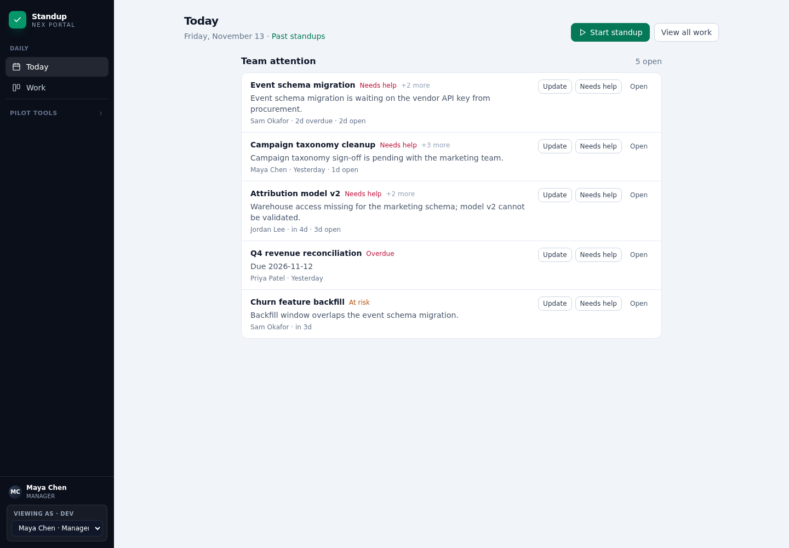
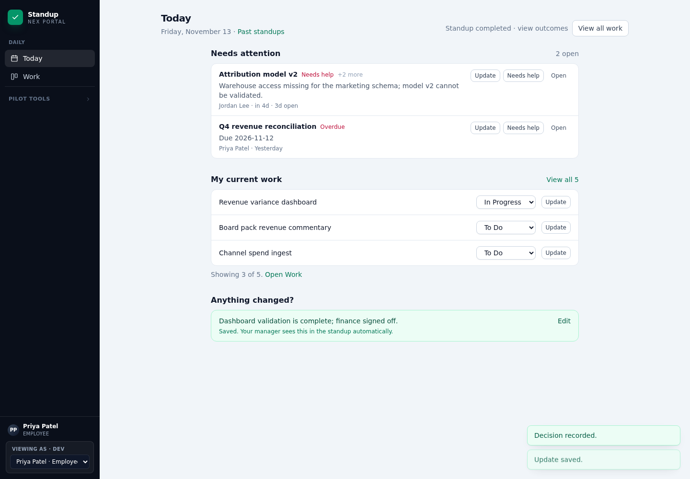
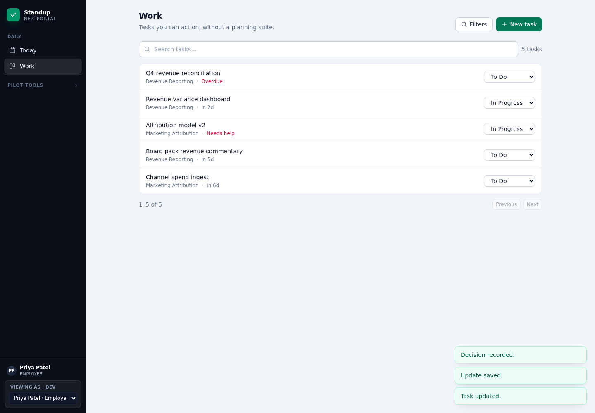
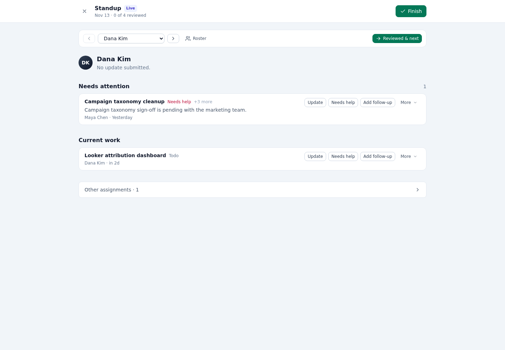
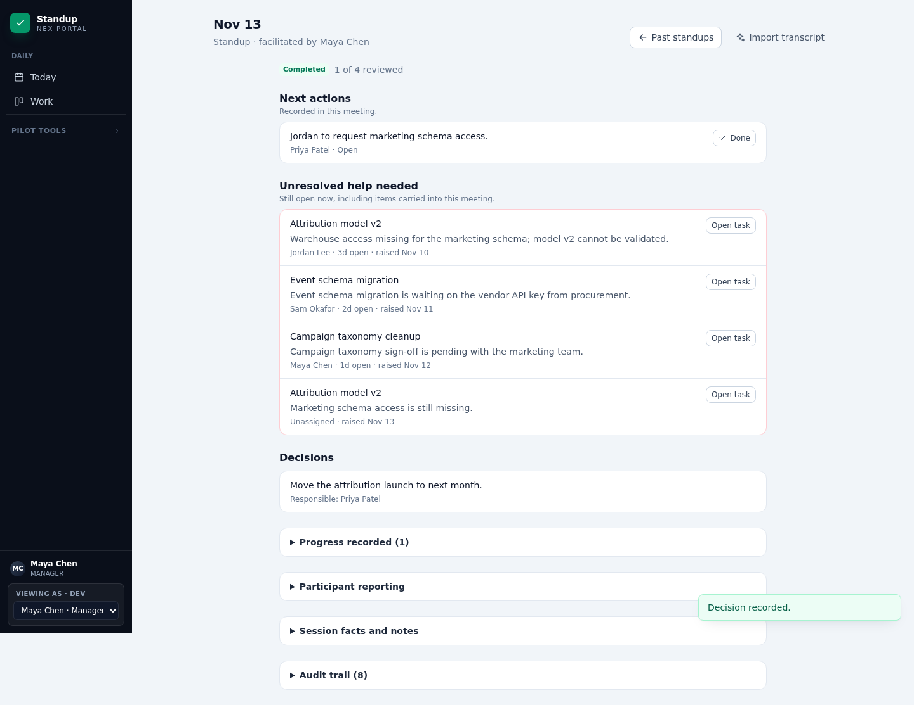
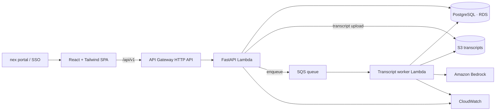

# Standup — daily work and a focused standup for nex

> Today answers three questions: what needs attention, what changed, and who is doing what next. The meeting is a focused mode, not a separate product to navigate.

This repository implements the **simplified** version of the standup-first application described in the project brief: **Today + Work**, a focused meeting workspace, and outcome-first session history. Intake, transcript reconciliation, project settings and the old Kanban remain available as pilot/legacy tools, but they are no longer part of the default daily experience.



---

## 1. What changed in the simplification

The previous iteration exposed seven equally prominent destinations and a permanent three-panel meeting screen. The product review and implementation addressed that directly:

| Before | Now |
|---|---|
| Seven manager destinations | **Today** and **Work**, plus a collapsed Pilot tools section |
| Overview-style Today with pulse tiles, history, carry-forward, and a duplicate task list | One attention queue, a short current-work preview, and one optional update composer |
| Employee questionnaire (progress + next steps + blockers + per-task updates) | One optional “Anything changed?” update, or a task-specific update, plus a distinct “Needs help” action |
| Three permanent meeting panels | One main workspace with a compact person selector, on-demand roster, and a contextual capture drawer |
| Five capture tabs and JSON-like records | Update / Needs help / Add follow-up, with Decision and General note under More |
| Duplicate Complete buttons, review bars and status badges | One Finish, one review count, one status or leading reason per row |
| Count-based, bookkeeping-heavy summary | Next actions, unresolved help, and decisions first; bookkeeping collapsed |
| Separate Projects, Board, Intake, AI destinations | Work list; project settings contextual to Work; intake/transcripts/legacy board under Pilot tools |

Old URLs are preserved through redirects: `/board` → `/work`, `/standup/today` → `/`, `/projects` → `/settings/projects`.

The plan itself is in [docs/simplification-plan.md](docs/simplification-plan.md). The architectural decision is recorded in [ADR-015](docs/decisions.md).

---

## 2. The daily product

### Today

**Managers** see one state-aware action (Start / Resume / View outcomes), a single deduplicated team attention queue, and a Past standups link. There is no manager “My work”, no pulse tiles and no recent-history panel.

**Employees** see their attention queue, a short current-work preview, and one optional composer:

- “Anything changed?” is one text field; a task link and next steps are optional.
- Updating a task from its row records one update and an optional status change in place.
- “Needs help” creates a durable blocker with an optional owner — not just a note for the meeting.
- “Done” completes an owned follow-up in place.
- Submitting collapses to a short saved receipt, not a permanent form.

Attention ordering is computed by the server and shared with the meeting workspace: blockers, overdue commitments, explicit risks, then follow-ups. A task with several exceptions appears once with additional reasons disclosed.



### Work

A searchable task list instead of a Kanban default:

- Task title, owner where useful, status, and relevant due/attention text.
- One search box and one Filters control.
- Common statuses through the filter; backlog/canceled remain stored and accessible.
- Inline status change and a shared task detail dialog for updates, blockers, follow-ups and history.
- Task creation requires an explicit project selection when more than one project exists.
- Project settings are reachable contextually from the filter panel by managers/project owners.
- Pagination covers the full result set.



### Focused standup



- The global navigation is removed in meeting mode.
- A compact person selector (previous/next, roster on demand) replaces the permanent participant column.
- The permanent capture column is gone; Update, Needs help and Add follow-up open a contextual drawer, with Decision and General note under More.
- One text field initially; owner/due date appear for follow-ups, and task context is shown and editable.
- “Reviewed & next” is the main navigation action; viewing someone never marks them reviewed.
- Finishing with unreviewed people requires an explicit override.
- Only one review count and one Finish action exist.
- The last saved capture is shown briefly in the header.
- Switching people with an unsaved draft prompts before discarding it.

### Outcomes, not statistics



The default summary shows:

1. **Next actions** — description, owner, due date, completion.
2. **Unresolved help needed** — blocker, owner, linked task, age and origin.
3. **Decisions** — what was agreed and why.

Progress records, participant reporting, session facts/notes and the audit trail are collapsed behind named details. Empty sections are hidden. The page clearly distinguishes what was recorded in the meeting from what is still open now.

Carry-forward is unchanged underneath: open blockers and action items survive session completion and appear in later meetings until resolved.

---

## 3. What is implemented

### Today / daily updates

- `GET /api/v1/today` returns the today session state, the server-ordered attention page, a current-work preview, and the current user’s daily update.
- `PUT /api/v1/daily-updates/today` is a one-row-per-user-per-day upsert; retries update the same record rather than duplicating it.
- Daily updates are visible in the meeting workspace even when no standup session existed when the employee wrote them.
- Durable help requests can be task-linked or team-wide. Employees may report either.
- Task updates, status changes and follow-up completion work from Today within existing permissions.

### Task foundation (preserved)

- Users and roles; projects, ownership and membership.
- Tasks with assignee, priority, workflow status, due date, at-risk flag/reason.
- Blockers are separate from workflow status and retain owner, resolution and carry-forward.
- Append-only progress updates, decisions and action items.
- Optimistic concurrency (`Task.version` → `409` with current version).
- Append-only audit events with actor, source, previous/new values and session linkage.
- The full task APIs and project permissions are unchanged; hiding controls in the simplified UI does not change authorization.

### Standup lifecycle (preserved)

- One session per date; draft → in-progress → completed.
- Participant review tracking, facilitator, timestamps, notes and deterministic summary.
- Pre-meeting submission endpoints remain for compatibility, but the UI now uses daily updates and durable help requests.
- Historical sessions, participant reporting and audit remain available.

### Pilot tools

- **Work intake** — retained behind Pilot tools; review/convert flow and permissions unchanged.
- **Transcript review** — retained for managers behind Pilot tools and from a session’s “Import transcript” action. Proposals now show readable before/after text instead of JSON, and keep evidence, confidence, duplicate/ambiguity warnings, approval and stale-version protection.
- **Legacy board** — available at `/legacy/board` during the pilot; `/board` redirects to Work.
- **Project settings** — moved to `/settings/projects`, linked contextually from Work.

### Not removed

Data, APIs and audit for intake, transcripts, proposals, participant flags and the board are preserved. Nothing was deleted from the database. Participant follow-up flags are retired from new UI use but remain in history. Backlog and canceled statuses remain in the database and are accessible through Work filters.

---

## 4. Quick start

### One command

```bash
./start.sh        # or: make start   (macOS, Linux, WSL or Git Bash)
```

It checks Python/Node, installs missing dependencies, seeds demo data if the database is empty, starts FastAPI and Vite, waits for health, and opens <http://localhost:5173>. Ctrl+C stops both processes.

Options:

```bash
NO_OPEN=1 ./start.sh
RESET=1 ./start.sh                      # rebuild demo data (destructive)
API_PORT=8001 WEB_PORT=5174 ./start.sh
```

Logs: `.dev/api.log`, `.dev/web.log`.

### Manual

```bash
make setup
make seed
make api      # terminal 1 → http://localhost:8000/api/docs
make web      # terminal 2 → http://localhost:5173
```

### Demo identities

| Identity | Role | Use |
|---|---|---|
| `manager@nex.local` | Manager | Start/resume a standup, triage team attention, finish outcomes |
| `priya@nex.local` | Employee | Daily update, task update, needs help |
| `jordan@nex.local` | Employee | Blocked engineering work |
| `sam@nex.local` | Employee | At-risk modelling work |
| `dana@nex.local` | Employee | Taxonomy blocker |
| `admin@nex.local` | Admin | User/role administration |

Switch identities from the bottom of the compact sidebar.

### Five-minute demo

1. As **Maya**, open Today. The team attention queue is the only work list; click **Start standup**.
2. In the focused meeting, use the person selector to choose **Priya**.
3. Click **Update** on a row. One field, one task context; save. The header briefly confirms the saved capture.
4. Click **Needs help**, describe the issue, optionally choose who can help, save.
5. Click **Add follow-up**; set an owner and optional due date.
6. Use **More → Decision** for an agreed outcome.
7. Click **Reviewed & next**; the review count advances and the next unreviewed person is selected.
8. Click **Finish**. If people are unreviewed, confirm the override. The outcome page shows Next actions, Unresolved help needed and Decisions.
9. Switch to **Priya**, open Today, write one “Anything changed?” update. No multi-question form; no duplicate task report.
10. Open **Work**: search, filter, change status, or open the shared task detail. No board columns in the default experience.

---

## 5. Architecture



- **Frontend:** React + Tailwind. Routes: `/` (Today), `/work`, `/standups`, `/standups/:id`, focused `/standups/:id/live` outside the global layout, `/settings/projects`, plus pilot routes and legacy redirects.
- **Backend:** FastAPI modular monolith. Routers → services → SQLAlchemy models. One transaction per request; audit rows commit with the mutation.
- **Database:** PostgreSQL in deployment, SQLite locally/tests; Alembic owns the schema (including `daily_updates`).
- **Auth:** nex SSO headers in `AUTH_MODE=nex`; `X-Dev-User` in local dev. RBAC remains in the application.
- **Attention ordering:** one service (`app/services/attention.py`) feeds Today and the meeting workspace. Both use the same exception definitions and severity order.
- **AI:** upload → S3 → SQS → worker Lambda → Bedrock → proposals → human review → apply with version check → audit. Mock extractor for tests/demos.

Detailed notes: [architecture](docs/architecture.md) · [data model](docs/data-model.md) · [API](docs/api.md) · [operations](docs/operations.md) · [decisions](docs/decisions.md).

---

## 6. Authorization summary

| Capability | Employee | Manager | Admin |
|---|---|---|---|
| View own work / projects they belong to | ✅ | ✅ | ✅ |
| Update own task, add own progress, change own status | ✅ | ✅ | ✅ |
| Report a task-linked or team-wide help request | ✅ | ✅ | ✅ |
| Reassign tasks / edit any task | — | ✅ | ✅ |
| Create/edit projects, manage membership | owner | ✅ | ✅ |
| Start/finish standups, review participants | — | ✅ | ✅ |
| Capture meeting updates/follow-ups/decisions/blockers | — | ✅ | ✅ |
| Write own daily update | ✅ | ✅ | ✅ |
| View team attention / full audit / approve AI proposals | own scope | ✅ | ✅ |
| Manage users and roles | — | — | ✅ |

Hiding a control is never used as authorization; the service layer enforces these rules.

---

## 7. Testing

```bash
make backend-test    # 48 pytest tests
make backend-lint    # ruff
make frontend-check  # tsc + production build
```

Backend coverage includes:

- auth modes, role elevation, RBAC and employee self-scope;
- task CRUD, optimistic concurrency and status transitions;
- blockers independent of workflow status; taskless/team-wide employee help requests;
- append-only updates, audit actor/source/session and audit scoping;
- daily update upsert and visibility in the meeting workspace;
- server attention ordering, deduplication, full-set pagination and empty/manager/employee scopes;
- session lifecycle, review/force-finish, captures, outcomes and historical review;
- intake review/conversion;
- AI no-auto-mutation, approve/apply/edit/reject, duplicates, ambiguous matches, stale-version conflicts and the SQS worker path.

The new flows were also exercised end-to-end in Chromium (manager Today → focused meeting → capture drawer → reviewed & next → outcomes → employee Today → Work → redirects → readable AI review) with zero console/page errors.

Pilot validation: [docs/pilot-checklist.md](docs/pilot-checklist.md).

---

## 8. Repository layout

```text
backend/
  app/
    api/          routers (today, daily updates, tasks, standups, intake, audit, ai)
    services/     attention ordering, today, standups, tasks, daily updates, AI
    models/       SQLAlchemy entities (including daily_updates)
    schemas/      Pydantic contracts
    ai/           mock + Bedrock extractors
    seed.py       demo analytics team and historical standups
    worker.py     SQS transcript worker
  migrations/     Alembic, initial schema + daily updates
  tests/          48 pytest tests
frontend/
  src/
    pages/        Today, Work, Session, Standups, Projects, Intake, AI, legacy Board
    components/   Layout, TaskDialog, TaskCreateDialog, TodayActions,
                  workspace/CaptureDrawer
    lib/          typed API client, auth, hooks
infra/terraform/  AWS reference stack
docs/             architecture, data model, API, operations, decisions, pilot, screenshots
```

---

## 9. Deployment (reference)

1. `cp infra/terraform/terraform.tfvars.example infra/terraform/terraform.tfvars` and fill the existing VPC/subnets, DB password and nex origin.
2. `terraform -chdir=infra/terraform init && terraform apply`.
3. Build/push the backend image to ECR (`linux/amd64`).
4. Set `api_image_uri` and apply again; both API and worker use the same image.
5. Run `alembic upgrade head` against RDS from a network-connected runner/bastion.
6. Build the frontend and host `dist/` in nex; point `VITE_API_BASE` at API Gateway if not same-origin.
7. Keep `AI_PROCESSING_INLINE=false` in deployment; the SQS worker handles transcripts.

VPC networking must provide egress or endpoints for S3, SQS and Bedrock. See [operations](docs/operations.md).

---

## 10. Scope and roadmap

| Phase | Scope | Status |
|---|---|---|
| 1 — Task foundation | users, projects, tasks, assignments, audit, auth | ✅ |
| 2 — Standup workspace | sessions, review, capture, carry-forward, history | ✅ (refocused meeting) |
| 3 — Task management / simplification | Today + Work, healthy meeting flow, outcomes summary, pilot gating | ✅ |
| 4 — AI transcript reconciliation | upload, extraction, proposals, human approval, conflicts, audit | ✅ pilot |
| 5 — Microsoft Teams integration | Graph transcript retrieval, automated processing | ⏳ not started |

### Deliberate deferrals

- **Single team workspace.** No multi-team tenancy yet.
- **No real-time collaboration.** Two managers do not live-sync; versions prevent silent overwrites.
- **No automatic session creation.** A manager starts today’s session from Today.
- **No notifications/email.**
- **No separate comment thread or attachments.** Task updates and session notes cover free text; transcripts are the only binary upload.
- **Capture retries.** Daily updates are idempotent upserts; append-only capture actions rely on UI submit guards. Full idempotency keys for every capture are a follow-up.
- **Legacy/pilot surface.** Board, intake, transcript review and project settings remain available during the pilot; they are not part of the default navigation.
- **Secrets.** The Terraform example passes the DB password as a variable for clarity; production should use Secrets Manager and consider RDS Proxy.
- **AI quality.** The mock extractor is deterministic; the Bedrock prompt needs validation against authorized real transcripts. Human approval is mandatory.

---

## 11. Documentation

- [docs/simplification-plan.md](docs/simplification-plan.md) — the product review and phased delivery plan.
- [docs/architecture.md](docs/architecture.md) — request lifecycle, attention ordering, meeting flow, AI pipeline.
- [docs/data-model.md](docs/data-model.md) — entities, relationships, invariants, audit.
- [docs/api.md](docs/api.md) — endpoint reference, including Today, daily updates, blockers and outcomes.
- [docs/operations.md](docs/operations.md) — environment, migrations, deployment, monitoring, security.
- [docs/decisions.md](docs/decisions.md) — ADRs, including ADR-015 (simplification).
- [docs/pilot-checklist.md](docs/pilot-checklist.md) — validation scenarios, targets and exit criteria.
