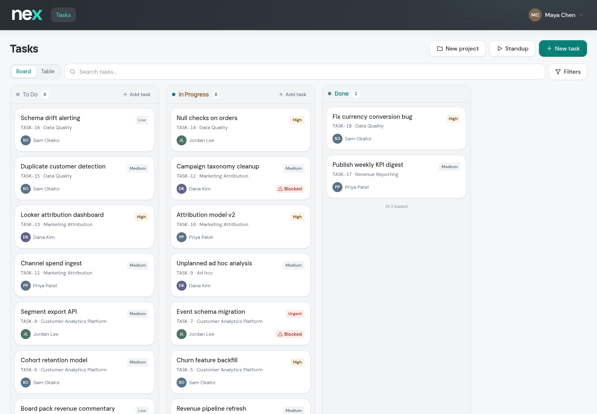
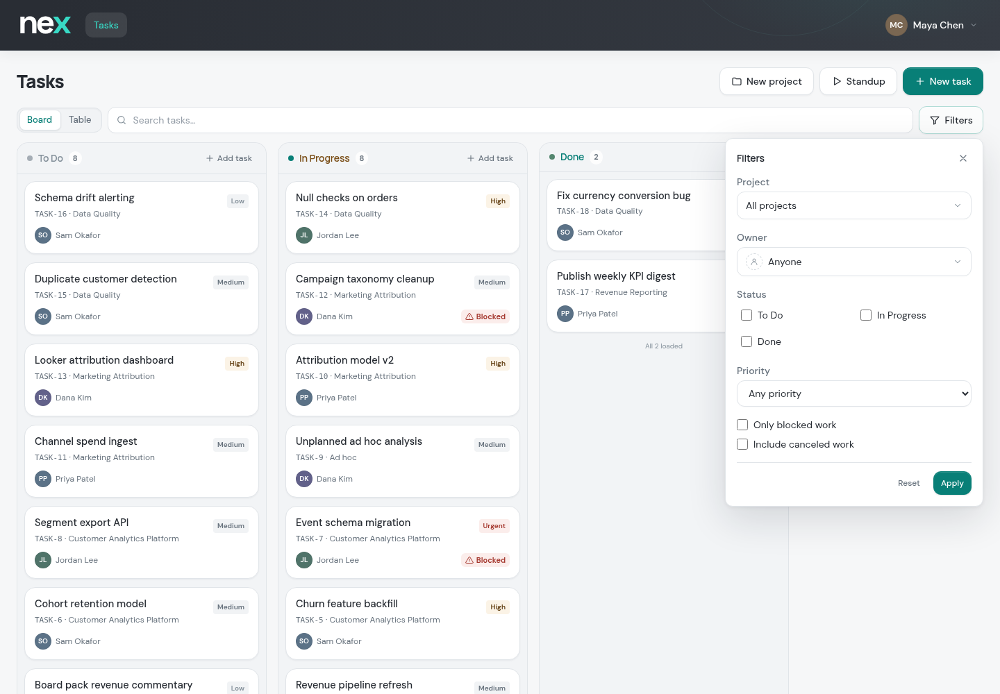
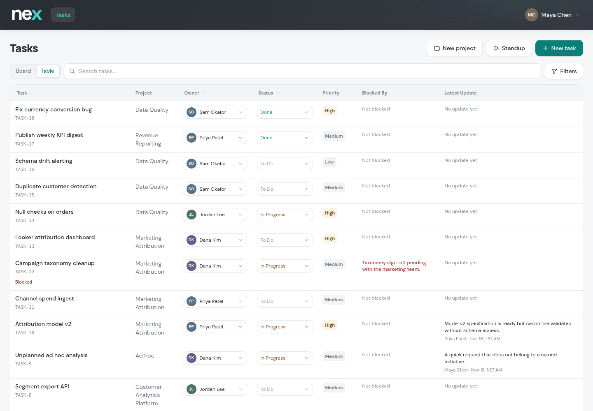
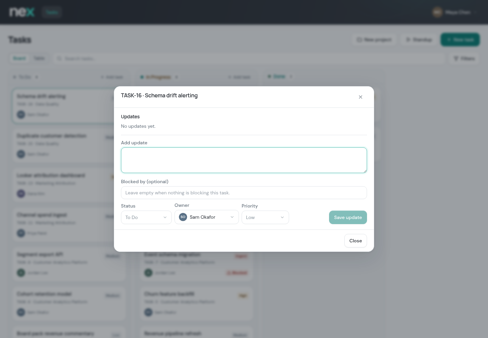
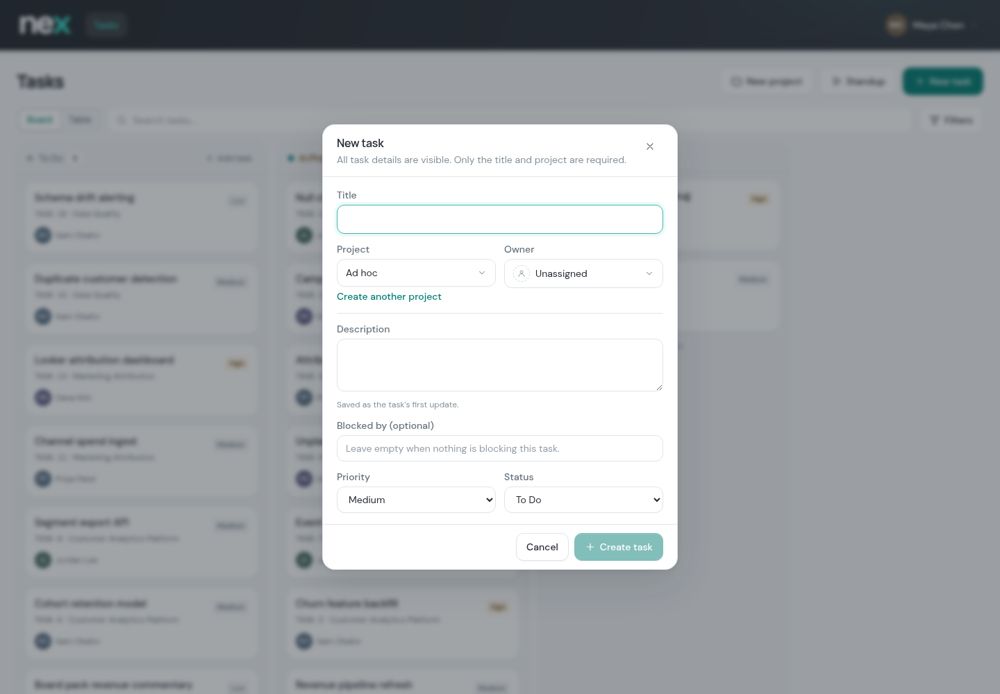
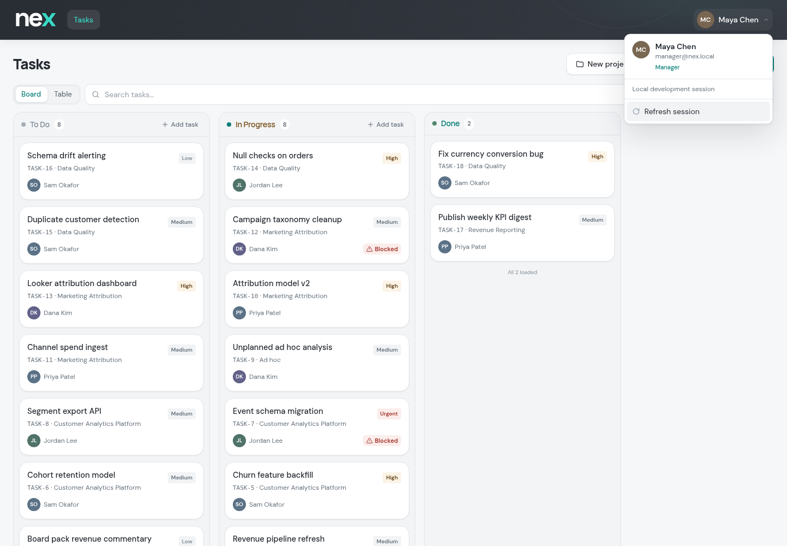

# Huddle — daily work and a focused huddle for nex

> Tasks holds the work in Board or Table, with a project filter and a lightweight project creator. A single **Huddle** button lets the manager review the work and return to Tasks.

This repository implements the Huddle application: **Tasks** (Board and Table) with project filtering and creation, plus a focused manager **Huddle** view entered from Tasks. Intake, transcript review, past-standup history and the legacy board have been retired from the active product; their historical data is retained.

It extends the **nex portal** and inherits the **nex Charcoal Neutral brand (v1.2)**: a charcoal gradient app header with the `nex` wordmark, off-white canvas, white surfaces, Action Teal interactions, and Manrope/DM Sans typography. The palette, wordmark, brand rules and machine-readable tokens are kept in [`docs/brand-kit/`](docs/brand-kit/); the app's semantic tokens live in `frontend/tailwind.config.js` and `frontend/src/index.css`.



---

## 1. What changed in the simplification

The previous iteration exposed seven equally prominent destinations and a permanent three-panel meeting screen. The product review and implementation addressed that directly:

| Before | Now |
|---|---|
| Seven manager destinations | One **Tasks** destination, a project filter, and one **Huddle** button; retired tools are gone |
| Persistent 208px sidebar | Compact app header with the Tasks navigation slot and an account control |
| Overview-style Today and a separate closed-work list | One task workspace with Board/Table presentations and a manager Huddle view |
| Employee questionnaire | One deduplicated check-in table with inline progress and a deliberate Ask for help action |
| Three permanent meeting panels | One main workspace with a compact person selector and inline session status |
| Five capture tabs and JSON-like records | Update / Needs help / Add follow-up, with Decision and General note under More |
| Duplicate Complete buttons, review bars and status badges | One Finish, one review count, one status or leading reason per row |
| Count-based, bookkeeping-heavy summary | Next actions, unresolved help, and decisions first; bookkeeping collapsed |
| Separate Projects, Board, Intake, AI destinations | Tasks (Board + Table) with project filter/create; intake/transcripts/legacy board removed from the active product |

Old URLs are preserved through redirects: `/work` → `/tasks`, `/board` and `/legacy/board` → `/tasks?layout=board`, `/projects` and `/settings/projects` → `/tasks`, and `/ai` or `/intake` → a retired notice. `/standup/today` → `/`.

The plan itself is in [docs/simplification-plan.md](docs/simplification-plan.md). The architectural decision is recorded in [ADR-015](docs/decisions.md).

---

## 2. The daily product

### Tasks

Tasks is the complete task workspace with **Board** and **Table** presentations of the same filtered task universe.

- The header has Board / Table, search, and one **Filters** control. There is no Team/My work toggle, standalone project dropdown, project-settings shortcut, or decorative task-count subtitle.
- The unified Filters surface is an anchored popover on desktop and an accessible sheet on mobile: project, owner (including **Assigned to me** and **Unassigned**), status, priority, needs-help, overdue, and one explicit **Include canceled work** option. Edits are draft-only until Apply; Cancel/Escape changes nothing. Filters appear as removable chips; **Clear filters** preserves layout, search and the open task.
- Each presentation is URL state (`/tasks?layout=board|table&…`); the last chosen presentation is remembered per user. Old `view`/`status`/`page` links and `/work` are normalized deliberately.
- **Board** keeps the polished Kanban, independent per-lane paging with honest totals, drag/keyboard/Move-to moves, real Undo, and the shared task sheet. Each card shows its priority in the top-right. Lane ordering is server-defined (due date, then most recently updated, then id); dragging changes status only.
- **Table** is server-paginated (~25 rows) and sorted over the full filtered set by task, owner, status or due date, with a stable tie-breaker. It includes a Priority column and exposes the same shared status/owner/date editors, latest-update excerpts and action menu. Board and Table never maintain independent filters or edit logic.
- The update dialog places **Status**, **Owner** and **Priority** side by side above Save update. Status, owner, priority and Blocked by changes share one version-checked task patch; progress is a dedicated update record whose text can be edited or deleted by its author or a manager, with the prior value retained in audit. **Save update** is enabled for any change. **Blocked by** belongs to the task: edit it in the Task card or when creating a task; the Table shows it as a read-only column.
- A **Description** entered while creating a task is also recorded as that task's first update, so it appears immediately in Latest update and the standup history.
- **Ctrl/Cmd + Enter** invokes the blue primary action of the current surface: **New task** on Tasks, **Create task** in the create dialog, **Save update** in the update dialog, **Apply** in Filters, and so on. Disabled/busy primary actions are skipped.
- On Tasks, pressing **Tab** when focus is on the page (not inside a form control, dialog or picker) switches **Board ↔ Table** only. Once focus enters a control, Tab is normal focus navigation again.
- Task detail remains the shared update dialog with the existing draft protection, capabilities and conflict recovery.










### Projects inside Tasks

Projects are task context, not a separate destination.

- The **Project** filter on Tasks scopes the Board or Table to one project; the active filter appears as a removable chip.
- Managers get a small **New project** button beside **Huddle** / **New task**. It opens a focused dialog for name, owner and members, then refreshes the filter options. Employees do not see project creation.
- Project list and creation APIs remain available, but the Projects page, project detail, member-management surface and old `/projects` destination are retired. `/projects` and `/settings/projects` redirect to Tasks.
- A designated **Ad hoc** project is provisioned idempotently for fresh and existing installations. It is the visible default project for global task creation, is a real project reference (not a null project), remains a valid team path, and cannot be archived while designated. Its id is found by a stable `system_key`, with a one-time adoption of a single legacy project literally named “Ad hoc”; duplicates require deliberate manual reconciliation.

### Account

The top-right control is a real account menu: name, email, role and authentication context, with keyboard navigation, Escape/outside dismissal and focus return. It includes only supported actions (currently a session refresh) — no identity switcher, fake sign-out, notifications or preferences. Local development opens as **Maya Chen**; production identity comes from nex SSO/Cognito.



### Huddle

The manager enters the Huddle from the single **Huddle** button in the Tasks header. There is no separate “Start Huddle”, “Resume Huddle”, “New Huddle” or results page.

- Opening the button starts today’s session if needed and enters the focused Huddle view; opening it again while a session exists returns to that view. A completed session opens the same view read-only with **Back to Tasks**.
- The view lays out one person’s work by In Progress / To Do / Blocked, with progress updates and task context. Owner and status are not repeated inside each row because the participant and group already identify them; there is no “Current work” heading.
- **Done** uses the same group heading/count pattern and card list, but starts collapsed behind a disclosure control. Update opens the shared task update dialog.
- **Back to Tasks** (top-left) and **Finish Huddle** both return directly to Tasks. There is no Past standups list, outcomes page or history archive.
- The session still records updates/decisions/notes for the existing workflow; historical rows remain in the database and audit, but the product no longer exposes browsing them.

Mobile: [Tasks Board](docs/screenshots/tasks-mobile.png) · [focused Huddle](docs/screenshots/meeting-mobile.png).

---

## 3. Trust and reliability

The polish pass focused on making the same small product behave predictably:

- Participant data is keyed by session + person; a slow switch shows a loading state and never leaves the previous person's tasks actionable under the new name.
- Task detail and capture combine progress with an optional status change in one backend transaction. A version conflict rolls back the whole operation.
- Client operation ids make task, blocker, follow-up, decision and note creation retry-safe; daily updates are upserts.
- Conflict recovery keeps the user's text and offers **Load latest state** before a deliberate re-save.
- Task/editor drafts are protected on Close, Cancel, Escape, backdrop click, participant change and Browser Back; pristine forms close immediately.
- Every page refetches when the authenticated identity changes; stale data from the previous user is never shown.
- Date labels use the server business date and complete wording (“Due in 4 days”, “2 days overdue”) instead of relative shorthand.

### Session state and daily updates

- `GET /api/v1/today` supplies the state of today’s session to the Tasks Huddle button; the Today page was removed. Daily updates remain available to the Huddle workspace.
- `PUT /api/v1/daily-updates/today` is a one-row-per-user-per-day upsert; retries update the same record rather than duplicating it.
- Daily updates are visible in the meeting workspace even when no standup session existed when the employee wrote them.
- Durable help requests can be task-linked or team-wide. Employees may report either.
- Task updates and status changes use the same version-checked services everywhere; no artificial “viewed” updates are written.

### Task foundation (preserved)

- Users and roles; projects, ownership and membership.
- Tasks with assignee, priority, workflow status, due date, at-risk flag/reason.
- Blockers are separate from workflow status and retain owner, resolution and carry-forward.
- Progress updates are editable/deletable by their author or a manager; audit events, decisions and action items remain append-only.
- Optimistic concurrency (`Task.version` → `409` with current version).
- Append-only audit events with actor, source, previous/new values and session linkage.
- The full task APIs and project permissions are unchanged; hiding controls in the simplified UI does not change authorization.

### Standup lifecycle (preserved)

- One session per date; draft → in-progress → completed. Opening the same day again reopens it; no history list is exposed.
- Participant review tracking, facilitator, timestamps, notes and deterministic summary.
- Pre-meeting submission endpoints remain for compatibility, but the UI now uses daily updates and durable help requests.
- Historical sessions, participant reporting and audit remain available.

### Retired tools

- Work intake, transcript review and the legacy board are removed from the active product: no routes, navigation, pilot gate, feature flag or worker consumption. There is no hidden replacement menu.
- `/ai` and `/intake` show a retired notice with links back to Tasks; no automatic conversion of intake requests and no task-drafting feature was added.
- Existing intake requests, transcripts, proposals and audit/history records are retained. No tables or historical data were deleted. The transcript event source mapping is disabled by default in Terraform (`transcripts_processing_enabled = false`) and `app.worker.handler` ignores messages without deleting them.
- Terraform still defines the retained S3 bucket, SQS queues and Lambda resources. Removing them is a separate, explicitly approved retention/cleanup operation.
- The account menu shows real identity/context only; there is no production role impersonation or user-facing identity switcher. Local development opens as **Maya Chen** (`manager@nex.local`); browser tests override the dev header identity out of band via local storage.

### Not removed

Project ownership/membership, blockers, follow-ups, decisions, standup sessions, audit and historical records are preserved. Backlog is a default board lane; canceled work is reachable through **Filters → Include canceled work** and through **Cancel task** on a card.

---

## 4. Quick start

### One command

```bash
./start.sh        # or: make start   (macOS, Linux, WSL or Git Bash)
```

It checks Python/Node, installs missing dependencies, seeds demo data if the database is empty, starts FastAPI and Vite, waits for health, and opens <http://localhost:5173>. Ctrl+C stops both processes.

Options:

```bash
NO_OPEN=1 ./start.sh
RESET=1 ./start.sh                      # rebuild demo data (destructive)
API_PORT=8001 WEB_PORT=5174 ./start.sh
./start.sh                              # if already running, opens/uses it
make stop                               # stop a running launcher instance
```

Logs: `.dev/api.log`, `.dev/web.log`.

### Manual

```bash
make setup
make seed
make api      # terminal 1 → http://localhost:8000/api/docs
make web      # terminal 2 → http://localhost:5173
```

### Demo identities

| Identity | Role | Use |
|---|---|---|
| `manager@nex.local` | Manager | Open the Huddle from Tasks, review current work, finish and return to Tasks |
| `priya@nex.local` | Employee | Daily update, task update, needs help |
| `jordan@nex.local` | Employee | Blocked engineering work |
| `sam@nex.local` | Employee | At-risk modelling work |
| `dana@nex.local` | Employee | Taxonomy blocker |
| `admin@nex.local` | Admin | User/role administration |

Local development opens as **Maya**; there is no identity switcher. Automated tests override the dev identity through local storage. Production identity comes from nex SSO/Cognito.

### Five-minute demo

1. As **Maya**, open Tasks. Review the Board or Table and click **Huddle**.
2. In the focused Huddle, use the person selector to choose **Priya**.
3. Click **Update** on a row. One field, one task context; save. The header briefly confirms the saved capture.
4. Click **Needs help**, describe the issue, optionally choose who can help, save.
5. Click **Add follow-up**; set an owner and optional due date.
6. Use **More → Decision** for an agreed outcome.
7. Click **Reviewed & next**; the review count advances and the next unreviewed person is selected.
8. Click **Finish**. If people are unreviewed, confirm the override. The outcome page shows Next actions, Unresolved help needed and Decisions.
9. Return to Tasks with **Back to Tasks**; switch between Board and Table, filter by project/owner, edit status inline, sort the table, and undo a move. Open the shared updates dialog from either presentation.
10. Filter Tasks by a project, or use **New project** to create one and filter to it. Create a global task and confirm the project defaults visibly to **Ad hoc**.

---

## 5. Architecture

```mermaid
flowchart LR
  Nex[nex portal / SSO] --> SPA[React + Tailwind SPA]
  SPA -->|/api/v1| APIGW[API Gateway HTTP API]
  APIGW --> API[FastAPI Lambda]
  API --> PG[(PostgreSQL · RDS)]
  subgraph Retained data · processing retired
    S3[(S3 transcripts)]
    SQS[SQS queues · event source disabled]
  end
  API -. retained records .-> S3
```

- **Frontend:** React + Tailwind. Routes: `/tasks?layout=board|table` (and `/` redirects there), focused `/standups/:id/live` outside the global layout, plus legacy redirects (`/projects`, `/settings/projects`) and retired notices. `/standups` and `/standups/:id` redirect to Tasks.
- **Backend:** FastAPI modular monolith. Routers → services → SQLAlchemy models. One transaction per request; audit rows commit with the mutation.
- **Database:** PostgreSQL in deployment, SQLite locally/tests; Alembic owns the schema (including `daily_updates`).
- **Auth:** nex SSO headers in `AUTH_MODE=nex`; `X-Dev-User` in local dev. RBAC remains in the application.
- **Check-in relevance:** one server service (`app/services/today.py`) defines the check-in scope, exception ordering and cutoff boundary; secondary commitments reuse the shared attention definitions.
- **AI:** upload → S3 → SQS → worker Lambda → Bedrock → proposals → human review → apply with version check → audit. Mock extractor for tests/demos.

Detailed notes: [architecture](docs/architecture.md) · [data model](docs/data-model.md) · [API](docs/api.md) · [operations](docs/operations.md) · [decisions](docs/decisions.md).

---

## 6. Authorization summary

| Capability | Employee | Manager | Admin |
|---|---|---|---|
| View own work / projects they belong to | ✅ | ✅ | ✅ |
| Update own task, add own progress, change own status | ✅ | ✅ | ✅ |
| Report a task-linked or team-wide help request | ✅ | ✅ | ✅ |
| Reassign tasks / edit any task | — | ✅ | ✅ |
| Create/edit projects, manage membership | owner | ✅ | ✅ |
| Start/finish standups, review participants | — | ✅ | ✅ |
| Capture meeting updates/follow-ups/decisions/blockers | — | ✅ | ✅ |
| Write own daily update | ✅ | ✅ | ✅ |
| View team check-in / full audit | own scope | ✅ | ✅ |
| Manage users and roles | — | — | ✅ |

Hiding a control is never used as authorization; the service layer enforces these rules.

---

## 7. Testing

```bash
make backend-test    # pytest
make backend-lint    # ruff
make frontend-check  # tsc + production build
npm --prefix frontend run test:e2e   # Playwright smoke (requires running app + seed)
```

The browser smoke covers the product shell end to end: the single Tasks navigation, account menu, To Do grouping, owner/title alignment and the blocked badge, Board/Table filter parity, table status edits and undo, the Add update composer, Ad hoc task creation, project creation from Tasks, the single Huddle button and direct return to Tasks, removed past-standup routes, and narrow-screen overflow. Set `CHROME_PATH` if Playwright's Chromium is not installed; CI installs it with `npx playwright install --with-deps chromium`.

Backend coverage includes:

- auth modes, role elevation, RBAC and employee self-scope;
- task CRUD, optimistic concurrency, status transitions and server-side sorting;
- blockers independent of workflow status; taskless/team-wide employee help requests;
- update create/edit/delete rules, audit actor/source/session and audit scoping;
- session state, daily updates, task updates and standup lifecycle;
- daily update upsert and visibility in the meeting workspace;
- Ad hoc provisioning/visibility/archive protection, scoped project counts, owner edits and project search;
- session lifecycle and review/force-finish; historical session records remain retained but are no longer exposed through a history UI or API.

Pilot validation: [docs/pilot-checklist.md](docs/pilot-checklist.md).

---

## 8. Repository layout

```text
backend/
  app/
    api/          routers (today, daily updates, tasks, standups, projects, audit)
    services/     check-in relevance, standups, tasks, projects/Ad hoc, daily updates
    models/       SQLAlchemy entities (including system-provisioned projects)
    schemas/      Pydantic contracts
    seed.py       demo analytics team and historical standups
    worker.py     retired transcript handler (ignores messages)
  migrations/     Alembic: initial schema, daily updates, project system key
  tests/          pytest contracts and behaviour
frontend/e2e/     Playwright product smoke journey
frontend/
  src/
    pages/        Tasks, Workspace (standup), Login, retired/not-found
    components/   Layout, AccountMenu, MorphSelect, task/filters/table, TaskDialog,
                  workspace/CaptureDrawer
    lib/          typed API client, auth, task query/display helpers
infra/terraform/  AWS reference stack (transcript processing disabled by default)
docs/             architecture, data model, API, operations, decisions, brand kit, screenshots
```

---

## 9. Deployment (reference)

1. `cp infra/terraform/terraform.tfvars.example infra/terraform/terraform.tfvars` and fill the existing VPC/subnets, DB password and nex origin.
2. `terraform -chdir=infra/terraform init && terraform apply`.
3. Build/push the backend image to ECR (`linux/amd64`).
4. Set `api_image_uri` and apply again. The API uses the image; the retained worker Lambda is not fed by SQS while transcript processing is disabled.
5. Run `alembic upgrade head` against RDS from a network-connected runner/bastion.
6. Build the frontend and host `dist/` in nex; point `VITE_API_BASE` at API Gateway if not same-origin.
7. Transcript review/processing is retired. Keep `transcripts_processing_enabled = false`; retained transcripts and queued messages are not processed or deleted by the active app.

VPC networking must provide egress or endpoints for S3, SQS and Bedrock. See [operations](docs/operations.md).

---

## 10. Scope and roadmap

| Phase | Scope | Status |
|---|---|---|
| 1 — Task foundation | users, projects, tasks, assignments, audit, auth | ✅ |
| 2 — Huddle workspace | sessions, review, capture, current manager view | ✅ (single Huddle button) |
| 3 — Task management | Tasks Board/Table, project filter/create, Ad hoc, manager Huddle view | ✅ |
| 4 — AI transcript reconciliation | retained data only; UI/API/worker consumption retired | ⏸ retired |
| 5 — Microsoft Teams integration | Graph transcript retrieval, automated processing | ⏳ not started |

### Deliberate deferrals

- **Single team workspace.** No multi-team tenancy yet.
- **No real-time collaboration.** Two managers do not live-sync; versions prevent silent overwrites.
- **No automatic session creation.** A manager opens the Huddle from the Tasks **Huddle** button.
- **No notifications/email.**
- **No separate comment thread or attachments.** Task updates and session notes cover free text; transcripts are the only binary upload.
- **Frontend regression tests.** A Playwright smoke script covers the critical journeys (`frontend/e2e/polish-smoke.mjs`), but there is no component-level frontend test suite yet.
- **Accessibility validation.** Focus trapping, labels, live regions and keyboard operation were checked in browser flows; a formal screen-reader audit and 200% zoom sweep remain manual pilot work.
- **Pilot status.** The validation in [docs/pilot-checklist.md](docs/pilot-checklist.md) has not been run with real users yet.
- **Manual board rank and touch drag.** Board moves change status only and touch uses Move to…; both are deliberate follow-ups.
- **Cognito integration.** Local development uses a fixed dev identity until the parent portal supplies the real account flow.
- **Secrets.** The Terraform example passes the DB password as a variable for clarity; production should use Secrets Manager and consider RDS Proxy.
- **Retained transcript data.** AI extraction/proposal application is no longer reachable from the app; retained records remain subject to the data-retention policy.

---

## 11. Documentation

- [docs/simplification-plan.md](docs/simplification-plan.md) — the product review and phased delivery plan.
- [docs/architecture.md](docs/architecture.md) — request lifecycle, check-in relevance, meeting flow, retained-data boundaries.
- [docs/data-model.md](docs/data-model.md) — entities, relationships, invariants, audit.
- [docs/api.md](docs/api.md) — endpoint reference, including tasks, projects, sessions, daily updates and blockers.
- [docs/operations.md](docs/operations.md) — environment, migrations, deployment, monitoring, security.
- [docs/decisions.md](docs/decisions.md) — ADRs, including ADR-015 (simplification).
- [docs/pilot-checklist.md](docs/pilot-checklist.md) — validation scenarios, targets and exit criteria.
- [docs/product-polish-handoff.md](docs/product-polish-handoff.md) — the trust/interaction polish brief implemented in this pass.
