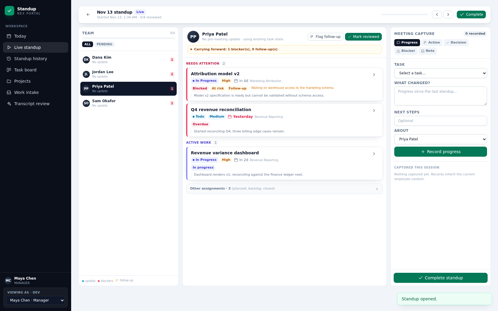
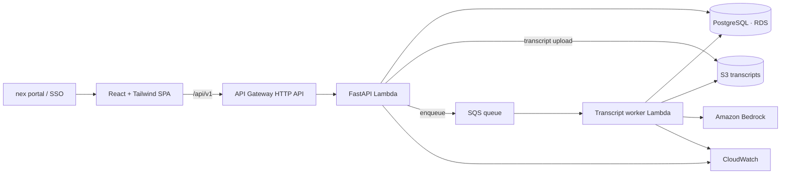

# Standup — a standup-first work management app for nex

> Tasks hold the current state of work. Standups capture progress, decisions, blockers and commitments. History preserves accountability. AI proposes; humans decide.

This repository implements the MVP described in the project brief: a lightweight project and task foundation wrapped around the **Daily Standup Workspace**, the application's primary interface.

**Status:** Phases 1–2 implemented and verified; Phase 3 (board/intake) delivered lightly; Phase 4 (transcript reconciliation) implemented behind human approval; Phase 5 (Microsoft Graph) intentionally out of scope.



---

## 1. The problem

The analytics team runs a daily standup where the manager reviews work, resolves blockers, sets priorities and records follow-ups. That information usually lives in conversation or a separate notes tool and has to be copied into a tracker afterwards. The result is duplicated effort, stale task records and commitments that disappear when the meeting ends.

Standup inverts the usual priority: instead of bolting a meeting view onto a generic task tracker, the meeting workspace is the product and the task foundation exists to support it.

### Product principles implemented

| Principle | Implementation |
|---|---|
| Standup-first | Three-panel live workspace is the primary route and the manager's default action |
| Minimal admin effort | Employees submit optional pre-meeting notes; existing task state and history are already visible |
| Exception-first | Tasks are grouped into Needs attention → Active → Other (collapsed) |
| Progressive disclosure | Task cards expand to blockers, follow-ups, previous updates and decisions |
| Structured accountability | Decisions, blockers and action items are first-class rows with owners |
| Carry-forward continuity | Open blockers and follow-ups remain queryable across every later session |
| Auditability | Append-only audit events written in the same transaction as each mutation |
| Human-controlled AI | Proposals are explicit operations; approve/edit/reject/apply is required |
| Reuse infrastructure | FastAPI + PostgreSQL + S3 + Bedrock, deployable on the existing AWS/nex stack |
| Validate before expanding | Scope is deliberately small; no Kubernetes, microservices or search cluster |

---

## 2. What is implemented

### 2.1 Daily Standup Workspace

- **Pre-meeting updates** — employees submit progress, next steps and blockers, optionally linked to their tasks. Submissions stay open during the live meeting until the manager marks that person reviewed.
- **Left panel: employee navigation** — pre-meeting indicator, review state, open blocker count and follow-up flag per participant; filters for all/pending.
- **Center panel: exception-first task view** — blocked, overdue, at-risk and follow-up work first; then active work; planned/backlog/closed work collapsed by default. Cards show title, project, status, priority, due date, latest update and expand into blockers, action items, prior updates and decisions. Status changes and blocker resolution happen inline.
- **Right panel: meeting capture** — Progress, Action item, Decision, Blocker and general Note forms. Records inherit the selected employee and task context. A live list shows everything captured in the session.
- **Session lifecycle** — create for a date, start, review participants, mark follow-up, complete with a generated structured summary. Sessions are historical records.
- **Carry-forward** — unresolved blockers and open action items remain attached to their origin session and appear in every later standup until resolved/completed.

### 2.2 Task foundation

- Users, roles, projects, project membership and ownership.
- Tasks with assignee, priority, workflow status (`backlog`, `todo`, `in_progress`, `done`, `canceled`), due date, at-risk flag and reason.
- Blockers are **separate** from workflow status: a task can stay `in_progress` while blocked.
- Append-only progress updates, comments-as-updates, decisions and action items.
- Optimistic concurrency via `Task.version` (stale edits return `409` with the current version).
- Audit trail with actor, source, timestamp, previous/new values, related session and entity.
- Kanban board with drag-and-drop (plus a status select for touch/keyboard), filters and a task editor.
- Lightweight work intake: submit → review → accept/reject → convert to task or project.
- Project overview with ownership, members and per-status task counts.

### 2.3 AI transcript reconciliation (Phase 4)

- Manual transcript upload (`.txt`, `.vtt`, `.md`) to S3 in deployed environments, local filesystem in dev.
- `mock` extractor for deterministic tests/demos and a Bedrock Converse adapter (`AI_PROVIDER=bedrock`).
- Existing-task matching and ambiguity flags; duplicate detection against records already captured in the session.
- Explicit proposals (`update_task_status`, `assign_task`, `add_progress_update`, `create_blocker`, `resolve_blocker`, `create_action_item`, `record_decision`) with evidence, speaker, timestamp and confidence.
- Manager review: edit payload, approve, reject, apply. **Nothing is auto-applied.**
- Conflict protection: applying re-checks the task version captured when the proposal was generated; stale proposals fail without overwriting newer data.
- Asynchronous processing path: upload enqueues to SQS, a worker Lambda performs extraction. Inline processing is available for local demo/tests.
- All proposals and applications produce audit events, including failure reasons.

### 2.4 Product screens

| Screen | Purpose |
|---|---|
| Today | Manager: session launch, team pulse, open blockers/follow-ups. Employee: pre-meeting form, my work, carry-forward, history |
| Live standup | Three-panel meeting workspace |
| Standup history / session detail | Historical review of reports, decisions, blockers, follow-ups and audit trail |
| Task board | Secondary Kanban view with drag/drop and filters |
| Projects | Ownership, members, status and task distribution |
| Work intake | Request submission, review and conversion |
| Transcript review | Upload, evidence-backed proposals, approval workflow |

More screenshots: [session summary](docs/screenshots/session-summary.png), [employee pre-meeting](docs/screenshots/pre-meeting-employee.png), [AI proposal review](docs/screenshots/ai-proposal-review.png), [board](docs/screenshots/board.png), [projects](docs/screenshots/projects.png).

---

## 3. Quick start

### Prerequisites

- Python 3.10+ and [uv](https://github.com/astral-sh/uv)
- Node.js 20+ and npm
- PostgreSQL only if you want to run against Postgres locally (SQLite is the default)

### Local development (SQLite)

```bash
make setup        # backend venv + frontend node_modules
make seed         # creates the demo analytics team, projects, tasks and 3 historical standups
make api          # terminal 1 → http://localhost:8000 (Swagger at /api/docs)
make web          # terminal 2 → http://localhost:5173
```

Open <http://localhost:5173>. The app starts as **Maya Chen (manager)**. Use the identity switcher at the bottom of the sidebar to experience the employee flow.

| Identity | Role | Use |
|---|---|---|
| `manager@nex.local` | Manager | Facilitate standups, review, capture decisions |
| `priya@nex.local` | Employee | Pre-meeting updates, own work |
| `jordan@nex.local` | Employee | Blocked engineering work |
| `sam@nex.local` | Employee | At-risk modelling work |
| `dana@nex.local` | Employee | Marketing attribution, taxonomy blocker |
| `admin@nex.local` | Admin | Administration |

### Docker (PostgreSQL)

```bash
make docker-up    # http://localhost:8080
make docker-down
```

The compose stack runs Postgres 16, applies Alembic migrations, seeds the demo workspace idempotently and serves the built SPA through nginx with `/api` proxied to FastAPI.

### Five-minute demo script

1. As **Maya**, click **Start standup** on Today.
2. Select **Priya Patel** in the left panel. The center shows `Attribution model v2` (blocked, at risk, open follow-up) and `Q4 revenue reconciliation` (overdue) before ordinary work.
3. Expand a task, change its status or resolve a blocker inline.
4. From a task card click **Log update**, **Report blocker**, **Follow-up** or **Decision**. The right panel preserves the selected task; captured records appear immediately.
5. Switch to **Priya** and submit a pre-meeting update from Today (allowed until she is reviewed).
6. Switch back to Maya, reopen the live session, confirm Priya's update appears in the workspace, then mark her reviewed.
7. Complete the standup. The summary is generated from structured records. Open **Standup history** to review it.
8. Open **Transcript review**, upload a transcript, and approve/apply a proposal. Note that the task does not change until approval, and that applying a stale proposal returns a conflict.

---

## 4. Architecture



- **Backend:** Python / FastAPI, modular monolith. Routers → services → SQLAlchemy models. One transaction per request; audit rows share the mutation's transaction.
- **Database:** PostgreSQL in deployed environments; SQLite for local tests/dev. Alembic owns the schema. All timestamps are naive UTC.
- **Auth:** the nex portal injects SSO headers (`X-Nex-User-Id`, `X-Nex-Email`, `X-Nex-Roles`, …). The API trusts them only in `AUTH_MODE=nex`; the gateway must strip client-supplied copies. Local `AUTH_MODE=dev` uses `X-Dev-User` and refuses to start outside local/dev/test.
- **Authorization:** application-level RBAC (employee/manager/admin) plus project ownership/membership checks.
- **AI:** upload → S3 → SQS → worker Lambda → Bedrock → PostgreSQL proposals → manager review → apply with version check → audit.
- **Infrastructure:** Terraform (VPC reuse, RDS, S3, ECR, two Lambdas, SQS + DLQ, API Gateway, CloudWatch alarms), GitHub Actions CI.

Detailed notes: [architecture](docs/architecture.md) · [data model](docs/data-model.md) · [API](docs/api.md) · [operations](docs/operations.md) · [decisions](docs/decisions.md).

---

## 5. Data model and audit in one minute

Core tables: `users`, `projects`, `project_members`, `tasks`, `task_updates`, `blockers`, `decisions`, `action_items`, `standup_sessions`, `standup_participants`, `session_notes`, `audit_events`, plus Phase 4's `transcripts` and `ai_proposals`.

- `tasks.status` is the current workflow state.
- `blockers` carry their own `open/resolved` state, owner, reporter, origin session and resolution details.
- `task_updates` are append-only.
- Carry-forward is computed live: open blockers and open action items are never copied or closed by ending a meeting.
- `audit_events` are append-only and include `source` (`employee_update`, `manager_action`, `task_interface`, `ai_approved`, `system`) and an optional `session_id`.
- `tasks.version` increments on every accepted edit and is used for both human optimistic concurrency and AI apply conflict detection.

See [docs/data-model.md](docs/data-model.md).

---

## 6. Authorization summary

| Capability | Employee | Manager | Admin |
|---|---|---|---|
| View own tasks / projects they belong to | ✅ | ✅ | ✅ |
| Update own task status, add own updates | ✅ | ✅ | ✅ |
| Reassign tasks / edit any task | — | ✅ | ✅ |
| Create/edit projects, manage membership | owner only | ✅ | ✅ |
| Create/start/complete standups, review people | — | ✅ | ✅ |
| Capture progress/actions/decisions/blockers in a session | — | ✅ | ✅ |
| Submit own pre-meeting update | ✅ (until reviewed) | ✅ | ✅ |
| View team-wide audit / approve AI proposals | own scope | ✅ | ✅ |
| Manage users and roles | — | — | ✅ |

---

## 7. Testing

```bash
make backend-test    # 42 pytest tests
make backend-lint    # ruff
make frontend-check  # tsc + production build
```

The backend suite covers:

- dev/nex authentication, role elevation and unknown identities;
- task CRUD, optimistic concurrency, status transitions and RBAC;
- blockers remaining separate from workflow status and preserving task state on resolution;
- append-only updates, audit actor/source/session fields and employee audit scoping;
- pre-meeting self-only submission and the live/late submission window;
- exception-first workspace classification and done-task exclusion;
- carry-forward across completed sessions and removal on resolution;
- review requirements, forced completion, generated summaries and session captures;
- historical employee reporting reconstruction;
- intake review and conversion;
- AI: no auto-mutation, approve/apply, editing, rejection, duplicate detection, ambiguous matches, stale-version conflicts and audit source.

The flows in the screenshots were exercised end-to-end in a real Chromium session (manager and employee identities, capture, pre-meeting, completion, board, intake, AI upload/approval) with no console errors.

---

## 8. Repository layout

```text
backend/
  app/
    api/          FastAPI routers (users, projects, tasks, standups, intake, audit, ai)
    ai/           extractor interface + mock + Bedrock adapter
    core/         auth, RBAC, errors, serializers
    models/       SQLAlchemy entities
    schemas/      Pydantic requests/responses
    services/     domain logic; transactions + audit
    main.py       app factory, error handlers, health
    seed.py       realistic demo dataset
    worker.py     SQS transcript worker
  migrations/     Alembic environment + initial schema
  tests/          pytest suite
frontend/
  src/
    components/   layout, UI primitives, standup workspace panels
    pages/        Today, Workspace, Session, Standups, Board, Projects, Intake, AI
    lib/          typed API client, auth context, hooks, formatting
  Dockerfile, nginx.conf
infra/terraform/  AWS reference stack (validated with terraform validate)
docs/             architecture, data model, API, operations, decisions, screenshots
.github/workflows/ci.yml
docker-compose.yml
Makefile
```

---

## 9. Deployment (reference)

1. `cp infra/terraform/terraform.tfvars.example infra/terraform/terraform.tfvars` and fill in the existing VPC/private subnets, DB password and nex origin.
2. `terraform -chdir=infra/terraform init && terraform apply`.
3. Build and push the backend image to the ECR repository output (`linux/amd64`):
   ```bash
   docker build --platform linux/amd64 -t "$API_IMAGE" backend
   docker push "$API_IMAGE"
   ```
4. Update `api_image_uri`, apply Terraform again. Both the API and worker Lambdas use the same immutable image.
5. Run `alembic upgrade head` once against the RDS instance from a network-connected CI runner or bastion.
6. Build the frontend (`npm run build`) and host `dist/` inside the nex portal; point `VITE_API_BASE` at the API Gateway URL if it is not same-origin.
7. Set `AI_PROVIDER=bedrock` when transcript extraction is approved; keep `AI_PROCESSING_INLINE=false` so the SQS worker handles it.

The reference Terraform is intentionally minimal. It assumes the existing nex VPC has NAT or VPC endpoints for S3, SQS and Bedrock. See [operations](docs/operations.md) for security and connection-management notes.

---

## 10. Scope and roadmap

| Phase | Scope | Status |
|---|---|---|
| 1 — Minimal task foundation | users, projects, tasks, assignments, statuses, priorities, audit, auth | ✅ |
| 2 — Daily Standup Workspace | sessions, pre-meeting, exception-first workspace, capture, carry-forward, history | ✅ |
| 3 — Task management enhancements | Kanban, intake, filtering, project overview | ✅ lightweight |
| 4 — AI transcript reconciliation | upload, extraction, matching, duplicates, proposals, approval, conflicts, audit | ✅ with mock + Bedrock adapter |
| 5 — Microsoft Teams integration | Graph transcript retrieval, automated processing, notifications | ⏳ not started |

### Known limitations / deliberate deferrals

- **Single team workspace.** There is no multi-team/organisation scoping yet; deployment is per team.
- **No real-time updates.** Two managers opening the same session do not live-sync; refresh is manual. Version checks prevent silent overwrites.
- **RDS connections.** Lambda concurrency is unbounded by default in Terraform for the API; add reserved concurrency or RDS Proxy before scaling past a small team.
- **Transcript extraction quality.** The mock extractor is heuristic and the Bedrock prompt is a starting point, not a tuned production model. Human review is mandatory and is the safety mechanism.
- **AI evidence retention.** Transcript retention is configurable in S3, but organisation-specific access control/retention policy still needs review before production use.
- **No separate comment thread.** Free-text task comments are represented by progress updates and session notes; a distinct comment stream is deferred.
- **No attachments on tasks.** Transcript files are the only binary upload in the MVP.
- **No notifications/email.** Follow-ups are visible in-app only.
- **Session creation is manual.** A manager creates today's session; there is no scheduled daily session generator yet.
- **Secrets.** The Terraform example passes the DB password through a variable for clarity; production should use Secrets Manager and an RDS Proxy.
- **Frontend deployment.** The SPA is built and hosted by nex; this repo does not assume S3/CloudFront frontend infrastructure.

---

## 11. Documentation

- [docs/architecture.md](docs/architecture.md) — request lifecycle, auth boundary, carry-forward, AI pipeline, concurrency.
- [docs/data-model.md](docs/data-model.md) — entities, relationships, invariants, indexes, audit.
- [docs/api.md](docs/api.md) — endpoint reference with roles and key errors.
- [docs/operations.md](docs/operations.md) — env vars, migrations, deployment, monitoring, security.
- [docs/decisions.md](docs/decisions.md) — ADR-style decisions and trade-offs.
