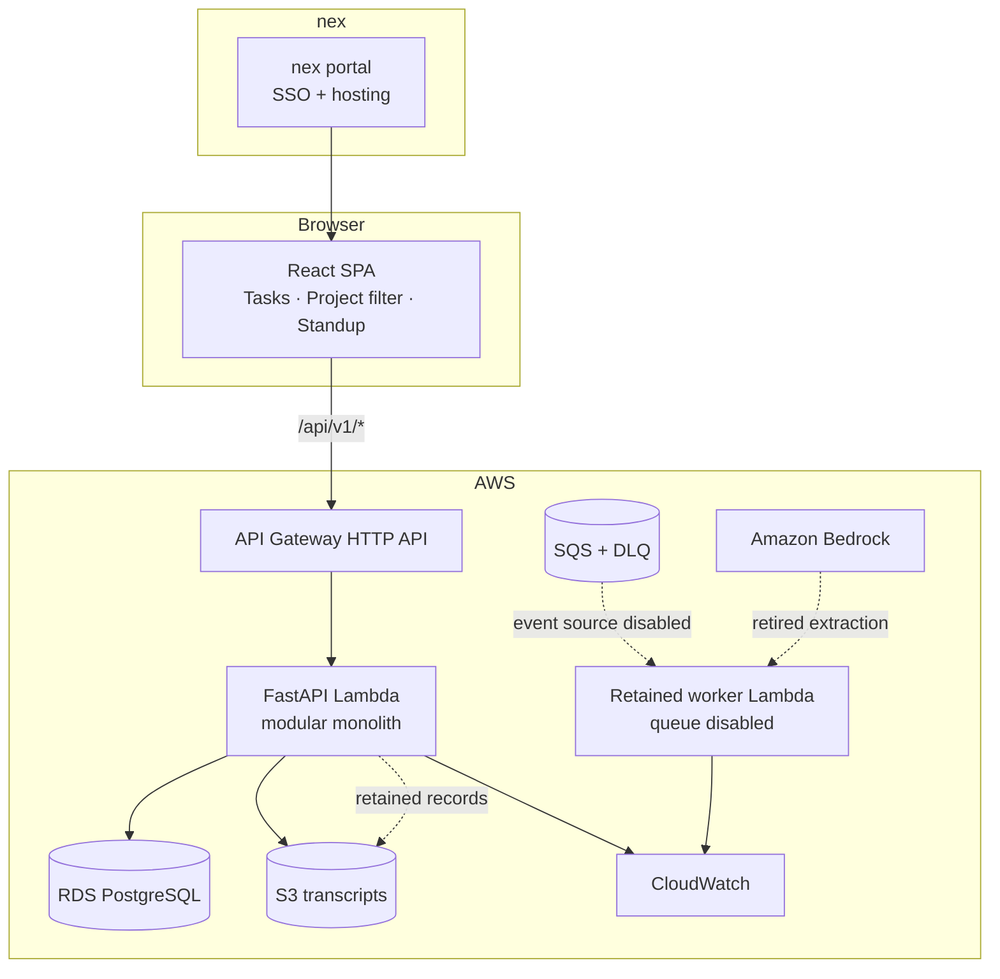

# Architecture

## 1. Context

The application is an internal tool for a small analytics team. It must feel like part of the **nex** portal (shared SSO, shared hosting), not a separate product with its own login. The workload is low-volume, read-heavy during a 15–30 minute standup, with short write bursts.

The daily product is deliberately small:

- **Tasks** — one task workspace with Board and Table presentations, a unified To Do category (backlog + todo), public task IDs, inline status/owner edits and a shared update dialog.
- **Brand** — extends the nex Charcoal Neutral v1.2 system (`docs/brand-kit/`): charcoal header, Action Teal on white, Signal Teal on charcoal, Manrope/DM Sans. Legacy utility palettes are remapped in `frontend/tailwind.config.js` so older pages inherit the theme.
- **Projects** — task context rather than a destination: a project filter on Tasks plus a small manager-only create dialog. Project data, memberships and authorized counts remain; the old Projects page/detail surface is retired. Includes the idempotently provisioned **Ad hoc** project.
- **Standup** — a navigation-free manager view entered from the single Tasks **Standup** button; a compact person selector, To Do/In Progress/Blocked groups, and direct return to Tasks. No past-standup history or outcomes page is exposed.

Work intake, transcript review, past-standup history and the legacy board are retired from the active product; their historical records are retained. Primary navigation has one destination, Tasks, plus a manager Standup button. The navigation bar remains in place for future pages; project context is handled inside Tasks.

Constraints from the brief:

- React + Tailwind frontend, Python + FastAPI backend.
- PostgreSQL as the system of record.
- Serverless compute on existing AWS infrastructure, Terraform, GitHub Actions.
- Reuse nex authentication; application-level RBAC.
- Modular monolith; no Kubernetes, microservices, vector DB or workflow engine.
- AI transcript processing is retired; retained AI records remain audit-only.

## 2. Component view



The frontend is a static SPA. In production it is served by nex; API calls go to API Gateway. Locally Vite proxies `/api` to FastAPI and docker-compose uses nginx for the same same-origin contract.

## 3. Backend layering

```text
app/api/*.py        HTTP boundary: dependencies, status codes, response models
app/services/*.py   domain rules, transactions, audit; no HTTP details
app/models/*.py     SQLAlchemy entities and relationships
app/schemas/*.py    Pydantic request/response contracts
app/core/           auth, RBAC, serializers, errors
app/ai/             extractor interface, mock extractor, Bedrock adapter
```

Routers are thin. Services receive `(db, user, payload)` and either return ORM/serialized objects or raise domain errors (`NotFoundError`, `ForbiddenError`, `ConflictError`, `DomainValidationError`). A single exception handler in `main.py` maps them to JSON with `{detail, code, details}`.

### Interaction shell and overlays

The app uses a compact charcoal header (brand, Tasks nav slot, account menu) rather than a persistent sidebar. Retired product surfaces have no build flag or hidden navigation. Local development has a fixed dev identity; production identity comes from nex SSO.

`Modal` and `Drawer` share one portal-based behavior: labelled dialog, initial focus, trapped focus, inert background, body scroll lock, topmost-only Escape, and focus restoration. Confirmations use the same primitive, so a nested discard prompt consumes Escape instead of closing the underlying task.

Tasks keeps layout, search, project/owner/status filters, sort, page and selected task in the URL. Board, Table and the standup view share one task/update surface and one capability model.

### Transaction model

`get_db()` opens a SQLAlchemy session per request and commits once on success:

```python
try:
    yield db
    db.commit()
except Exception:
    db.rollback()
    raise
finally:
    db.close()
```

Services only `flush()`. Consequences:

- A task mutation and its audit event commit atomically.
- A progress update and an optional status change commit in one transaction; a stale version rolls back both.
- Multi-row operations (creating a session and its participants, applying a proposal and recording audit) are atomic.
- Create/update commands accept a unique `client_operation_id`. Reusing it for the same logical submission returns the original row instead of duplicating progress, tasks, help requests, follow-ups, decisions or notes.
- The retired AI apply path kept its conflict record (`proposal.failed`) in a separate commit; retained history still shows the failure reason.

### SQLite / PostgreSQL portability

- String UUID primary keys (`String(36)`) avoid dialect-specific UUID handling.
- Enums are stored as `VARCHAR` (`native_enum=False`), so no PostgreSQL enum migrations are needed.
- JSON columns use SQLAlchemy `JSON` (JSONB can be introduced without changing the API).
- Timestamps are naive UTC (`utcnow()`); the SPA treats the API values as UTC.
- SQLite is used for tests and local development; PostgreSQL is the production target. `alembic check` runs in CI to prevent schema drift.

## 4. Authentication and authorization

### Authentication boundary

Two modes:

| Mode | Use | Identity source |
|---|---|---|
| `dev` | local, tests, demos | `X-Dev-User` (email or user id), defaults to `DEV_DEFAULT_USER_EMAIL` |
| `nex` | deployed | `X-Nex-User-Id`, `X-Nex-Email`, `X-Nex-Name`, `X-Nex-Roles` |

In `nex` mode the first request for an unknown identity provisions a user as an employee. Roles from `X-Nex-Roles` can elevate a user (`manager`, `admin`) but never demote them; de-provisioning is an explicit admin action. The API **trusts the headers**, so the nex gateway must strip any client-supplied copies before proxying. This is documented as an operational requirement.

`dev` mode refuses to run unless `ENVIRONMENT` is local/dev/development/test/ci.

### Authorization

RBAC is applied in `core/rbac.py`:

- **Employee** — read own tasks/projects they belong to; update own task status; add own updates; submit own pre-meeting note.
- **Manager** — all read; manage projects/tasks; facilitate sessions; review participants; capture meeting records.
- **Admin** — manager plus user/role management.

Project visibility also considers ownership and `project_members`. Task visibility considers manager/admin, assignee, creator and project owner. The checks run in services, not only in routers, so every entry point is protected.

## 5. Standup workflow

### 5.0 Daily updates and durable help

The standup view and task update dialog write through the same session/task services:

- **Daily update** — one optional `daily_updates` row per user per day. `PUT /daily-updates/today` upserts, so retries update rather than duplicate. The meeting workspace reads the participant's update for the session date, and session detail exposes it under participant reporting.
- **Help request** — “Needs help” creates a Blocker, task-linked or team-wide. Employees may create either (with project visibility enforced). It is durable and carries forward; it is not stored only as participant text.

Task-specific updates use the existing append-only task update endpoint with source `task_interface`, so they appear in the meeting's recent updates without a second submission.

### 5.1 Session lifecycle

```text
draft ──start──▶ in_progress ──complete──▶ completed
```

- One session per calendar date (`unique(session_date)`).
- Creating a session snapshots participants (`standup_participants`), skipping admins and users with `standup_eligible=false`.
- `start` sets `started_at`; `complete` sets `ended_at`, generates a structured summary and writes audit. Completion never resolves blockers or closes action items.
- The focused meeting auto-starts a draft session when the facilitator opens it. Daily updates are independent of the session and remain visible for the session date; the legacy pre-meeting API also stays open until the participant is reviewed.

### 5.2 Shared attention ordering

`app/services/attention.py` defines the shared exception vocabulary used by the standup workspace and the retained `/today` projection:

1. open blocker / help request — 100
2. overdue — 80
3. explicitly at risk — 60
4. open follow-up — 50

Task cards expose priority in the top-right; the Table has a dedicated Priority column; the update dialog keeps Status, Owner and Priority together above Save update.

The standup view groups one participant’s work into To Do (todo + backlog), In Progress and Blocked, then Done collapsed. The expanded Done list uses the same card treatment as the other groups. Rows do not repeat owner/status (the selected participant and group already carry that context), and no separate “Current work” heading is shown. `/today` remains a server projection used for session state; there is no Today page or second task store.

### 5.3 Carry-forward

Carry-forward is **query-driven**, not copied:

```text
open blocker  → status = 'open' AND (owner = employee OR reported_by = employee OR task.assignee = employee)
open action   → status = 'open' AND (owner = employee OR task.assignee = employee)
```

They keep their `reported_session_id` / `session_id` origin, so history can answer “when was this first raised?”. Ending a session does not mutate them. Resolving/completing removes them from later workspaces automatically. This avoids duplicate records and guarantees continuity.

### 5.4 Focused meeting and capture context

The meeting route (`/standups/:id/live`) is rendered outside the global layout. The UI has one main workspace, a compact person selector with the session status/review count inline, one review action and one Finish action. Capture opens the shared task update dialog:

- `POST /standups/sessions/{id}/updates` creates an append-only `TaskUpdate` with `source=standup`, `session_id`, author = manager, `attributed_to_user_id` = selected employee.
- blockers/action items/decisions inherit `session_id`. Owners are explicitly selected where relevant; the UI does not silently infer who can resolve a blocker.
- Notes are stored as `session_notes`.
- Every capture writes an audit event with `source=manager_action` and the session id.
- Switching participants while a draft exists prompts before discarding it; “Mark reviewed & next” marks only the current participant and advances. There is no roster panel.
- Capture freezes the task version when the draft opens. Background workspace refreshes cannot silently move the expected version; conflicts require **Load latest state** and a deliberate re-save.
- SPA Back while a draft is open uses a same-URL history guard and the in-app discard confirmation.

### 5.5 Session completion

Finishing the standup returns directly to Tasks. No outcomes/history page is reachable; the underlying session, updates, decisions and notes remain retained in the database and audit.

## 6. Date semantics

The API defines the team business day as the server's UTC date and exposes it at `GET /meta` (also on `/today`). The SPA uses that date for due/overdue and daily-update context. Timestamps remain UTC and are rendered in the browser's local time. Closed tasks with historical due dates show a date, not “overdue”.

## 7. Retained transcript data (processing retired)

Transcript review/upload, proposal review and AI proposal application have been removed from the active UI, API and navigation. The database models, historical transcripts/proposals and audit records are retained under the data-retention policy. The SQS event source mapping is disabled by default in Terraform (`transcripts_processing_enabled = false`), and `app.worker.handler` ignores queued messages without deleting them. Removing the retained S3/SQS/Lambda resources is a separate operation requiring explicit approval.

## 8. Concurrency and consistency

- **Task edits** accept `expected_version`. Mismatch → `409` with `current_version` and `expected_version`. Human UIs use this in the board/table/update dialog and standup view; retained AI apply records also enforced it.
- **Session date** is unique, so a duplicate create returns `409` with the existing session id.
- **Review/complete** checks are explicit: completing with unreviewed participants requires `force=true`; the response lists who is unreviewed.
- **No distributed locks.** A small team and optimistic checks are sufficient for the MVP. Real-time multi-manager synchronisation is deferred.
- **Audit is append-only.** There are no update/delete endpoints for audit rows. Corrections create new records.

## 9. Failure behaviour

| Failure | Behaviour |
|---|---|
| Validation | `422` with field-level details |
| Missing entity | `404` |
| Wrong role/ownership | `403` |
| Stale version / duplicate session / closed session | `409` with structured `details` |
| DB integrity race | `409` via `IntegrityError` handler |
| Unexpected DB error | `500` JSON; no partial commit |
| Transcript extraction error | transcript `failed`, error stored, audit event; job retried/DLQ |
| Legacy AI apply conflict (retained) | proposal `failed`, failure reason, task untouched |

## 10. Performance and scaling notes

- Standup reads are bounded by team size and use `selectinload` for task relationships.
- Aggregates (per-session open counts, per-participant blocker/action counts) are done with grouped queries, not N+1 loops.
- Lambda → RDS connections are the main scaling constraint. The API Lambda is small; RDS Proxy or reserved concurrency should be added before a large rollout. The retained worker’s event source is disabled by default; its concurrency cap remains in Terraform for a future approved use.
- Static frontend assets are served by nex/nginx, not Lambda.
- The database holds all operational history; no separate search infrastructure is needed at this scale.

## 11. Non-goals for this iteration

Kubernetes, microservices, event sourcing, vector search, configurable workflow engines, separate authentication, Teams Graph retrieval, real-time collaboration. These are deferred until usage demonstrates a need.
