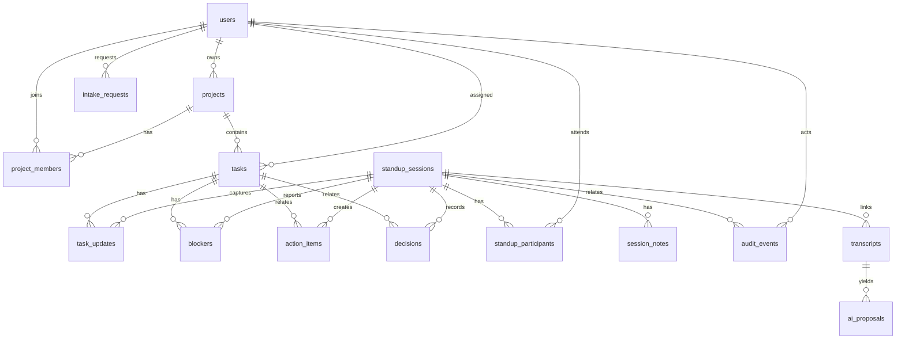

# Data model

## 1. ER overview



## 2. Tables

### users

| Column | Notes |
|---|---|
| `id` | UUID string |
| `external_id` | nex SSO subject; unique, nullable for dev users |
| `email` | unique, stored lower-case |
| `full_name` | display name |
| `role` | `employee`, `manager`, `admin` |
| `is_active` | inactive users cannot authenticate |
| `standup_eligible` | included in default session participants |

### projects / project_members

`projects`: `name`, `description`, `owner_id`, `status` (`active`, `paused`, `completed`, `archived`).

`project_members`: join table with `role` (`lead`, `member`); unique on `(project_id, user_id)`. The owner is also kept as a member for visibility.

### tasks

Current state only. History lives elsewhere.

| Column | Notes |
|---|---|
| `project_id` | required |
| `title`, `description` | |
| `assignee_id` | nullable |
| `priority` | `low`, `medium`, `high`, `urgent` |
| `status` | `backlog`, `todo`, `in_progress`, `done`, `canceled` |
| `due_date` | date, nullable |
| `is_at_risk`, `at_risk_reason` | independent of workflow status |
| `created_by_id` | |
| `completed_at` | set when entering `done`, cleared on reopen |
| `version` | starts at 1; incremented on every accepted edit |

Indexes: `(assignee_id, status)`, `(project_id, status)`, `due_date`, `updated_at`.

**Blockers are not a status.** `status` and blocker state are orthogonal: a task can be `in_progress` and `is_blocked=true` (computed from open blockers).

### task_updates (append-only)

One row per progress report. Never overwritten.

`task_id`, `author_id`, `attributed_to_user_id` (manager capturing on behalf of an employee), `session_id`, `source` (`pre_meeting`, `standup`, `task_interface`, `ai_approved`, `system`), `progress`, `next_steps`, `created_at`.

Index: `(task_id, created_at)`, `session_id`.

### blockers

`task_id` (nullable for team-wide blockers), `project_id`, `description`, `owner_id`, `reported_by_id`, `reported_session_id`, `status` (`open`/`resolved`), `resolved_at`, `resolved_by_id`, `resolved_session_id`, `resolution_details`.

Indexes: `(status, task_id)`, `(owner_id, status)`, `reported_session_id`.

Resolution history across multiple cycles is preserved in `audit_events`; the blocker row holds the current resolution. For the MVP one blocker = one resolution. A future enhancement could add a `blocker_events` history table if multiple reopen/resolve cycles are needed.

### decisions

`session_id` (nullable), `task_id` (nullable), `project_id` (nullable), `description`, `rationale`, `decided_by_id`, `responsible_user_id`, `created_at`. Decisions can be general or linked to work.

### action_items

`session_id`, `task_id` (nullable), `description`, `owner_id`, `due_date`, `status` (`open`, `completed`, `canceled`), `completed_at`, `completed_by_id`, `created_by_id`.

Index: `(status, owner_id)`, `session_id`.

Carry-forward selects `status='open'` and owner/assignee match. Completing or canceling removes it from later workspaces.

### standup_sessions

| Column | Notes |
|---|---|
| `session_date` | unique, one per day |
| `status` | `draft`, `in_progress`, `completed` |
| `facilitator_id` | manager running the meeting |
| `started_at`, `ended_at` | |
| `summary` | deterministic text generated at completion |
| `notes` | optional closing notes |

### standup_participants

Unique `(session_id, user_id)`. Fields:

- `pre_meeting_progress`, `pre_meeting_next_steps`, `pre_meeting_blockers`, `pre_meeting_submitted_at`
- `reviewed_at`, `reviewed_by_id`
- `follow_up_flagged`, `follow_up_note`

Pre-meeting submission stays open while the session is draft **or** in progress, until the participant is reviewed. This supports late arrivals without reopening a completed session.

### session_notes

Free-text notes attached to a session, authored by a manager. Structured records are preferred; notes capture context that does not fit a type.

### intake_requests

`title`, `description`, `requester_id`, `requester_name` (external requests), `priority`, `status` (`new`, `under_review`, `accepted`, `rejected`, `converted`), `reviewed_by_id`, `review_note`, `converted_task_id`, `converted_project_id`.

### transcripts

`session_id`, `filename`, `content_type`, `storage_key` (S3 URI or local path), `content_text`, `size_bytes`, `uploaded_by_id`, `status` (`uploaded`, `processing`, `processed`, `failed`), `error`, `processed_at`.

Transcript text is stored in the row for evidence and duplicate detection; S3 holds the authorized source file. Retention must follow company policy.

### ai_proposals

`transcript_id`, `session_id`, `operation`, `target_type`, `target_id`, `payload` (JSON), `current_values` (JSON snapshot at generation), `evidence_excerpt`, `speaker`, `spoken_at`, `confidence`, `is_ambiguous`, `duplicate_of_type`, `duplicate_of_id`, `status` (`pending`, `approved`, `rejected`, `applied`, `failed`), `base_task_version`, reviewer fields, `applied_at`, `failure_reason`.

**States**

```text
pending ──approve──▶ approved ──apply──▶ applied
   │                     │
   ├────reject──▶ rejected
   └──── apply conflict / validation ──▶ failed
```

`failed` is used for conflicts and validation failures during apply. The reviewer sees the reason and can reject/close or reprocess the transcript.

### audit_events (append-only)

| Column | Notes |
|---|---|
| `id` | UUID |
| `event_type` | e.g. `task.updated`, `blocker.resolved`, `standup.completed`, `ai_proposal.applied` |
| `entity_type`, `entity_id` | polymorphic reference |
| `actor_id`, `actor_type`, `actor_label` | user or system |
| `occurred_at` | UTC |
| `previous_values`, `new_values` | JSON snapshots where meaningful |
| `source` | `employee_update`, `manager_action`, `task_interface`, `ai_approved`, `system` |
| `session_id` | when the event happened in a standup |
| `context` | extra detail (changed fields, proposal result, etc.) |

Indexes: `(entity_type, entity_id, occurred_at)`, `(session_id, occurred_at)`, `event_type`, `occurred_at`.

No update/delete API exists for audit rows. Corrections are new events.

## 3. Invariants

1. A task has exactly one current status; blockers never overwrite it.
2. A session date is unique. A participant exists at most once per session.
3. Completing a session does not change blocker/action-item state.
4. `task_updates` and `audit_events` are append-only.
5. A task edit and its audit event commit together.
6. A task edit with a stale `expected_version` is rejected.
7. An AI proposal can only be applied after approval, and only if `Task.version` still matches `base_task_version`.
8. Action items/decisions/blockers keep the session they originated from even after later sessions.
9. Task updates preserve `attributed_to_user_id` separately from the author, so manager-captured updates remain attributable to the employee.
10. Users are never silently demoted by SSO headers.

## 4. Common queries

| Question | Query |
|---|---|
| Open blockers for a person | `blockers.status='open' AND (owner_id=? OR task.assignee_id=?)` |
| Carry-forward action items | `action_items.status='open' AND (owner_id=? OR task.assignee_id=?)` |
| Needs attention | task has open blocker OR `due_date < today` OR `is_at_risk` OR open action item |
| Session review progress | `participants reviewed_at is not null / total` |
| What did Alice report last week? | `standup_participants` for Alice join sessions in range; updates where `session_id` and (`attributed_to` or `author` = Alice) |
| How did a task progress? | `task_updates` for task ordered by `created_at`; audit events for status/assignment changes |
| When was a blocker first raised? | `blockers.created_at`, `reported_session_id`, and the `blocker.created` audit event |

## 5. Migrations

- Alembic is the schema authority. The initial migration (`migrations/versions/*_initial_schema.py`) creates all tables and indexes.
- `alembic check` runs in CI against a fresh database to detect model/migration drift.
- The API never calls `create_all` in production; `AUTO_INIT_DB` is false by default and SQLite auto-init is limited to local/test.
- Timestamps are naive UTC, both in SQLite and PostgreSQL.
